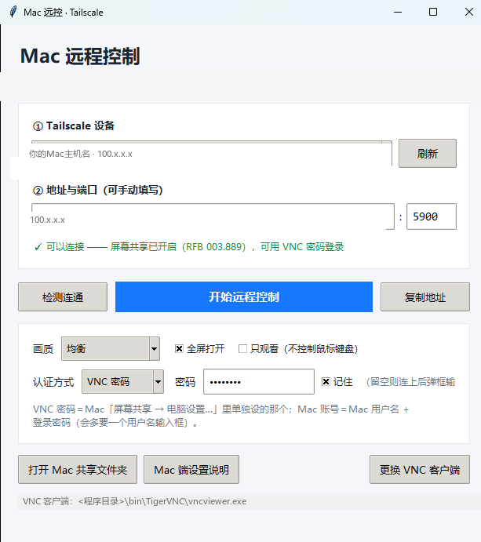

# Mac 远控（MacRemote）

用 Tailscale 打洞，从 Windows 一键远程控制家里的 Mac 图形界面。
**不需要在 Mac 上安装任何第三方远控服务端** —— 直接复用 macOS 自带的「屏幕共享」（VNC，5900 端口）。

一个 tkinter 单文件小程序 + 便携 VNC 客户端，双击就能用。

---

## 为什么需要它

- 家里的 Mac 在 Tailscale 私网里，没有公网 IP，也不方便做端口映射；
- RustDesk / TeamViewer 这类工具要在 Mac 上装服务端，而实测其默认端口在
  部分网络下根本不通；
- 而 macOS 自带的「屏幕共享」本身就是一个标准 RFB/VNC 服务端，只要在系统
  设置里勾选就能用 —— 所以只需要一个趁手的「客户端外壳」。

## 下载与安装

去 [Releases](https://github.com/congyb001/MacRemote/releases) 页下载，两种形态任选：

| 包 | 文件 | 说明 |
|---|---|---|
| 安装版 | `MacRemote-Setup-1.0.0.exe` | 双击安装，**不需要管理员权限**（装到 `%LOCALAPPDATA%\Programs\MacRemote`），带开始菜单项、可选桌面快捷方式、标准卸载入口 |
| 便携版 | `MacRemote-Portable-1.0.0.zip` | 解压到任意目录，双击 `Mac远控.exe` 即用，不写注册表 |

两个包都已内置 TigerVNC 1.16.2 便携客户端（安装时可在「组件」页取消勾选），
并附带 GPL 许可证原文与第三方组件声明。

> 安装包和主程序**没有代码签名**，Windows SmartScreen 可能提示「已保护你的电脑」，
> 点「更多信息 → 仍要运行」即可。

## 界面



> 截图中的主机名与 IP 已替换为占位值。

## 程序做了什么

| 功能 | 说明 |
|---|---|
| Tailscale 设备自动发现 | 调 `tailscale status --json`，自动挑出 macOS 主机并回填 IP |
| 真·连通检测 | 不是 ping，而是完整跑一次 RFB 握手，判断服务端版本与可用认证方式 |
| 三色结果 | 🟢 可直接连 / 🟠 只接受 Apple 账号认证或未设密码 / 🔴 连不上，附原因 |
| 内置客户端 | 自动查找程序目录下的 `bin\TigerVNC\vncviewer.exe` 等便携客户端 |
| 画质三档 | 高速（局域网）/ 均衡 / 省流量，映射为 `-CompressLevel` + `-QualityLevel` |
| 全屏 / 只观看 | 一键切换，只观看适合演示、监看 |
| 两种认证 | VNC 密码（默认）/ Mac 账号密码 |
| 密码免手输 | 界面填的密码通过子进程环境变量 `VNC_PASSWORD` 传给客户端，不落盘 |
| 启动失败可见 | 客户端 stderr 落盘到 `vnc_last.log`，4 秒内异常退出会弹窗报具体原因 |
| 顺手的小功能 | 打开 Mac 共享文件夹（`\\<ip>`）、Mac 端设置说明、一键准备 VNC 客户端 |

## 原理

```
┌──────────── Windows ────────────┐        ┌──────── Mac (macOS) ────────┐
│  Mac远控.exe (tkinter GUI)      │        │                             │
│    │ ① tailscale status --json │        │                             │
│    ▼                          │        │                             │
│  设备列表 / IP                │        │                             │
│    │ ② RFB 握手探测 5900      │  Tailscale 私网 (100.x.x.x)          │
│    ▼                          │◄──────►│  屏幕共享 (VNC Server)      │
│  vncviewer.exe  ──③ RFB 3.8──┼────────►│  5900                       │
│         ▲                     │        │                             │
│         └ env: VNC_PASSWORD   │        │                             │
└───────────────────────────────┘        └─────────────────────────────┘
```

关键点：**VNC 密码只通过子进程环境变量传递**。TigerVNC 的 `-PasswordFile`
参数要求的是 DES 混淆后的二进制密码文件，直接喂明文会被当成错误的密码，
表现为「界面里填了密码反而提示密码错误」——这个坑本项目已经踩过并绕开。

## 快速开始

### 1. Mac 端（一次性设置）

1. 系统设置 → 通用 → 共享 → 打开 **屏幕共享**；
2. 点「电脑设置…」→ 勾选 **「VNC 显示程序可以使用密码控制屏幕」** → 设一个
   密码（**8 位以内**，标准 VNC 密码认证只认前 8 位）；
3. 防火墙放行「屏幕共享」；
4. 想让它一直可连，可以在终端跑 `caffeinate -dimsu &` 防止休眠；
5. 验证：`nc -z 127.0.0.1 5900 && echo OK`。

详细版见 [`docs/Mac 端设置.txt`](docs/Mac%20端设置.txt)。

### 2. Windows 端

1. 安装 Tailscale，登录与 Mac 相同的账号；
2. 运行 `Mac远控.exe`；
3. 从下拉框选你的 Mac（或手输 `100.x.x.x` 和端口 `5900`）；
4. 点「检测连通」确认是绿色；
5. 点「开始远程控制」。

界面里填了 VNC 密码就不会再弹密码框；留空则由客户端弹框让你手输。

## 从源码运行

```powershell
python app.py
```

依赖：Windows 10/11、Python 3.9+（带 tkinter）、Tailscale CLI。

## 打包

```powershell
python -m PyInstaller --noconfirm --onefile --windowed --name "Mac远控" `
  --icon app.ico --add-data "app.ico;." `
  --distpath dist --workpath build --specpath build app.py
```

产物是单文件 exe。**注意：exe 内部不含 VNC 客户端**，客户端需要放在
`bin\TigerVNC\vncviewer.exe`（程序内「准备 VNC 客户端」可自动安装）。

### 打包安装包 / 便携包

需要 [Inno Setup 6](https://jrsoftware.org/isinfo.php)（脚本会自己补简体中文语言文件）：

```powershell
pwsh -File installer/build-installer.ps1
# 可选参数：-AppExe <主程序路径> -AppDir <客户端目录> -Version 1.0.1
```

产物落在 `installer/dist/`：

- `MacRemote-Setup-<版本>.exe` —— 安装版（免管理员，装到 `%LOCALAPPDATA%\Programs\MacRemote`）
- `MacRemote-Portable-<版本>.zip` —— 便携版

> ⚠️ 这两个包里会打进去 TigerVNC 的 `vncviewer.exe`（GPL-2.0）。
> 对外分发前请按 [THIRD-PARTY-NOTICES.txt](THIRD-PARTY-NOTICES.txt) 履行 GPL 义务：
> 附许可证原文（安装包已自动带上 `bin\TigerVNC\LICENCE.TXT`）、提供对应源码或有效承诺、
> 不附加额外限制。本仓库的 Releases 已同时提供源码（就是这个仓库）与上游地址。

## 已知限制

- **没有画面缩放**：内置 TigerVNC 1.16.2 移除了 `-Scaling` / `-FitWindow`
  这类参数（实测全部 `Unrecognized option`），全屏是 1:1 原生像素。把 Mac 的
  显示器分辨率调成与 Windows 一致，全屏就正好铺满。
- **VNC 密码只认前 8 位**，这是 RFB 协议本身的限制，不是本程序的。
- **密码不是加密存储**：勾「记住」时用 XOR + base64 混淆写进本地
  `config.json`，只能防肩窥，不要存高价值密码。
- 只支持标准 VNC 密码认证（security type 2）与 macOS 的 Apple 认证类型；
  连接 `-SecurityTypes=VncAuth` 时不会弹用户名框。
- macOS 屏幕共享不响应 `RemoteResize`，远端不会跟着窗口改分辨率。

## 安全提示

- 只在**自己的 Tailscale 私网**里用。不要把 5900 暴露到公网，也不要为此做
  端口映射。
- VNC 协议本身没有现代加密，Tailscale 的 WireGuard 隧道是它的安全边界。
- 程序会把最近一次客户端的 stderr 写到 `vnc_last.log`，其中可能含目标 IP，
  分享日志前先看一眼。

## 文件结构

```
MacRemote/
├── app.py                  主程序（GUI + RFB 探针 + 客户端启动封装）
├── app.ico                 应用图标
├── make_icon.py            图标生成脚本（Pillow）
├── LICENSE                 MIT（仅覆盖本项目原创代码）
├── THIRD-PARTY-NOTICES.txt 第三方组件与许可说明（含 GPL 义务清单）
├── installer/
│   ├── installer.iss       Inno Setup 安装包脚本
│   ├── build-installer.ps1 一键出安装包 + 便携包
│   └── BEFORE-INSTALL.txt  安装前须知（显示在安装向导里）
└── docs/
    ├── 使用说明.txt         给最终用户的操作说明
    ├── Mac 端设置.txt       Mac 那边的一次性设置
    └── screenshot.png       界面截图
```

## 第三方组件

本仓库**不分发** TigerVNC 的二进制。程序以独立子进程的方式调用用户本地
已有的 VNC 客户端。详见 [THIRD-PARTY-NOTICES.txt](THIRD-PARTY-NOTICES.txt)。

如果你要发布附带 `vncviewer.exe` 的开箱即用版本，请先履行 GPL-2.0 义务：
附许可证全文与版权声明、提供对应源码或书面承诺、不得附加额外限制。

TigerVNC 与本项目没有隶属或背书关系，本项目只是它的使用者。

## License

本项目原创代码采用 [MIT](LICENSE)。第三方组件各自遵循其原有许可。
